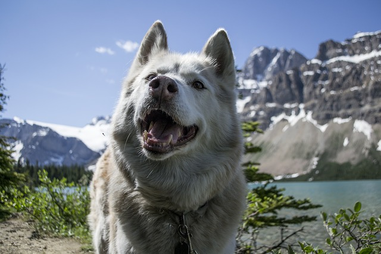
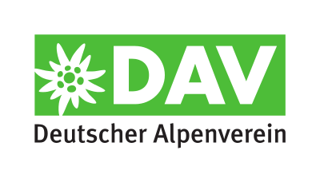
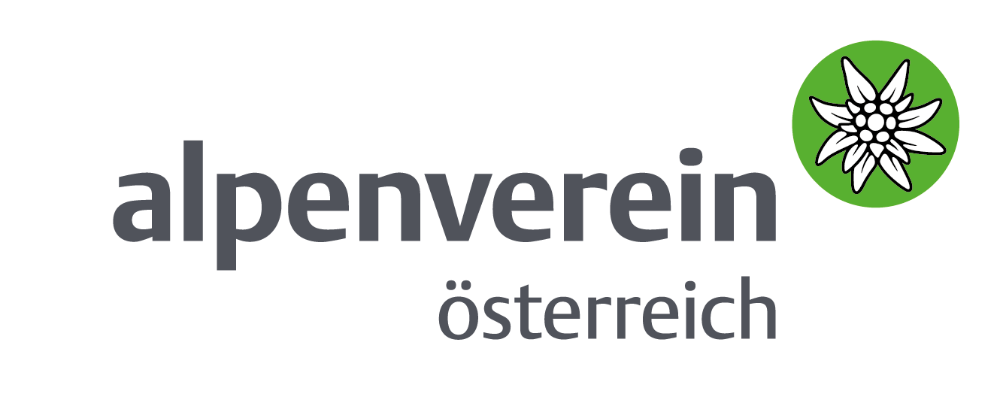
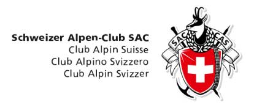

# The Alpine unions

## General information

Alpine clubs are hiking and mountaineering organizations found in several European countries. Membership is also open to foreign participants. Membership requires a fee and offers several benefits:

* Discounts on accommodation in mountain huts;
* Insurance that can cover expenses in an emergency;
* Free use of topographic maps;
* Discounts on climbing equipment rental;
* Access to training courses, instructional literature, maps and so forth;

See "Benefits of membership in European Alpine clubs" (Russian): [http://spryquest.com/blog/blog\_46.html?l=ru](http://spryquest.com/blog/blog_46.html?l=ru)

Membership fees vary by club and regional branch.

Whether joining an Alpine club and paying membership dues is worthwhile for foreign participants is an individual decision. A discussion on the Risk forum (Russian): [https://www.risk.ru/blog/15122](https://www.risk.ru/blog/15122).

Instructions for applying for membership, with a detailed guide to joining an Alpine club (Russian): [http://www.kombrig.net/vstuplenie\_v\_alpklub.htm](http://www.kombrig.net/vstuplenie_v_alpklub.htm).

 [Image by M. Maggs from Pixabay](https://pixabay.com/photos/highway-mountain-trees-forest-2498002/)

In any case, learning about the activities of Alpine clubs is useful for hikers. Their websites, which are freely available to everyone, offer a wealth of current, first-hand information. You can find:

* Tourist maps of regions;
* Information about mountain huts;
* Information about hiking safety;
* Current information about weather and route conditions;
* The latest hiking news, etc.

## The German Alpine Union. Deutscher Alpenverein (DAV)

> The German Alpine Club (German: Deutscher Alpenverein, DAV) is the world's largest climbing association, and the eighth-largest sports union in Germany. The Club is a member of the German Olympic Sports Confederation, and the responsible body for sport and competition climbing, hiking, mountaineering, hill walking, ice climbing, mountain expeditions, as well as ski mountaineering.
> [https://en.wikipedia.org/wiki/German\_Alpine\_Club](https://en.wikipedia.org/wiki/German_Alpine_Club)

The figures given here list 354 legally independent associations and clubs, with around 988,000 members. The club brings together professionals and enthusiasts in mountaineering, rock climbing, mountain hiking, ice climbing, ski mountaineering and mountain biking.

ASS insurance covers all of Europe, including the Caucasus. Worldwide coverage is available for an additional fee.  
Membership dues differ from section to section, depending on their size and offers. Adult membership costs from 45 to 90 euros for a calendar year.

Official site: [https://www.alpenverein.de/](https://www.alpenverein.de/)

Some interesting pages:

* The map of mountain huts [https://www.alpenverein.de/DAV-Services/Huettensuche/](https://www.alpenverein.de/DAV-Services/Huettensuche/)
* Responses about mountain huts [https://www.alpenverein.de/Huetten-Wege-Touren/Huettentest/](https://www.alpenverein.de/Huetten-Wege-Touren/Huettentest/)
* Statistics of incidents [https://www.alpenverein.de/Bergsport/Sicherheit/Unfallstatistik/](https://www.alpenverein.de/Bergsport/Sicherheit/Unfallstatistik/)

## The Austrian Alpine Union. Österreichischer Alpenverein (ÖAV)

Official site: [http://www.alpenverein.at](http://www.alpenverein.at/portal/index.php)

The website lists news and events from regional sections. For example: Innsbruck [http://www.alpenverein.at/innsbruck/](http://www.alpenverein.at/innsbruck/) (The club website offers the magazine "Alpine Bulletin")

On the Austrian Alpine Club website there is a list of mountain shelters and huts on regions: Austria, Germany, Italian Tirol [https://www.alpenverein.at/huetten/finder.php](https://www.alpenverein.at/huetten/finder.php)

Insurance AWS (the Austrian Alpine Union) [https://oeav.mitgliederversicherungsservice.at/informationen/die-alpenvereinsversicherung/](https://oeav.mitgliederversicherungsservice.at/informationen/die-alpenvereinsversicherung/)

Annual payment (2019) - €57,00 (Sections Alpine Club with open offices the whole day long and the expanded service offer can earn hardly higher membership dues. For deliveries indemnification of expenses abroad is raised.)

Regional sections (some):

* Vienna [https://www.alpenverein-austria.at/](https://www.alpenverein-austria.at/)
* Salzburg [https://www.alpenverein-salzburg.at/](https://www.alpenverein-salzburg.at/)

## The Swiss Alpine union

Official site: [https://www.sac-cas.ch/](https://www.sac-cas.ch/)

Search of mountain huts (only Switzerland) [https://www.sac-cas.ch/de/huetten-und-touren/sac-tourenportal/](https://www.sac-cas.ch/de/huetten-und-touren/sac-tourenportal/)

## The Italian Alpine union

Official site: [http://www.cai.it/](http://www.cai.it/)

Regional sections (some):

* The Italian Alpine union of South Tyrol [https://www.alpenverein.it/](https://www.alpenverein.it/)
