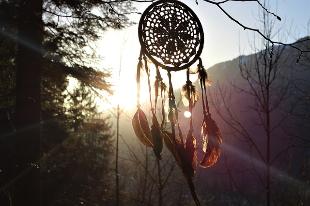

# The related (or similar)

Among [the things that attract people to hiking](hiking), autonomy, self-sufficiency and a sense of "open space" matter greatly, both literally and metaphorically. For most hikers, however, this is a temporary state: they change their usual way of life for a hike and then return home. This makes it especially interesting to learn about people for whom such a state has become a permanent lifestyle. We are not discussing professionals who earn a living from tourism while helping others. Below is a brief overview of other outlooks and links for further reading.

 [Image by Aline Berry from Pixabay](https://pixabay.com/photos/dream-catcher-feather-sunset-forest-3299832/)

## Naturism, nudists, "savages"

Naturism is a modern outlook whose central idea is to bring people closer to nature for the health of body and spirit.

> Naturism, or nudism, is a cultural and political movement practicing, advocating, and defending personal and social nudity, most but not all of which takes place on private property. The term may also refer to a lifestyle based on personal, family, or social nudity.\[1\] Naturism may take a number of forms. It may be practiced individually, within a family, socially, or in public. Additionally, there is also militant naturism, including campaigning, and extreme naturism is sometimes considered a separate category.
> [https://en.wikipedia.org/wiki/Naturism](https://en.wikipedia.org/wiki/Naturism)  
> "Savages" formally refers to people living in a primitive state of civilization. Some writers, however, have used the word metaphorically to describe an outlook close to naturism.

## Hippie

> A hippie is a member of the counterculture of the 1960s, originally a youth movement that began in the United States during the mid-1960s and spread to other countries around the world. The word hippie came from hipster and was used to describe beatniks who moved into New York City's Greenwich Village and San Francisco's Haight-Ashbury district. The term hippie first found popularity in San Francisco with Herb Caen, who was a journalist for the San Francisco Chronicle.
> [https://en.wikipedia.org/wiki/Hippie](https://en.wikipedia.org/wiki/Hippie)

Hippies are generally thought to believe in the following ideas:

* The person should be free;
* Freedom can be achieved only by changing one's inner life;
* The actions of an inwardly free person are guided by the desire to preserve freedom as a precious possession;
* Beauty and freedom are inseparable, and realizing both is a spiritual task;
* All who share these beliefs form a spiritual community;
* A spiritual community is the ideal form of communal life;

> Hippies formed a subculture that arose in the United States in the early 1960s, spread rapidly around the world and largely faded by the mid-1970s. The original movement consisted mostly of white teenagers and young adults aged fifteen to twenty-five, who inherited a spirit of cultural rebellion from bohemian circles and the beatniks. Hippies challenged established ideas and middle-class values, opposed nuclear weapons and the Vietnam War, and popularized aspects of religions other than Judaism and Christianity. They helped advance the sexual revolution and encouraged psychedelic drug use to expand consciousness. They also created communes in which their values were cultivated.
> [http://www.sub-culture.ru/hippy.php](http://www.sub-culture.ru/hippy.php)

## Communards

In the context of this site, a communard is a member of a modern communal settlement.

> A commune (the French word appearing in the 12th century from Medieval Latin communia, meaning a large gathering of people sharing a common life; from Latin communis, things held in common) is an intentional community of people living together, sharing common interests, often having common values and beliefs, as well as shared property, possessions, resources, and, in some communes, work, income or assets. In addition to the communal economy, consensus decision-making, non-hierarchical structures and ecological living have become important core principles for many communes. There are many contemporary intentional communities all over the world, a list of which can be found at the Fellowship for Intentional Community (FIC)
> [https://en.wikipedia.org/wiki/Commune](https://en.wikipedia.org/wiki/Commune) **Interesting references:**

* To live without the state: Five communes where build the new world [https://apparat.cc/world/5-communes-new-world/](https://apparat.cc/world/5-communes-new-world/)

## Downshifting

> The term downshifting in the English language refers to the act of reducing the gear ratio while driving a vehicle with manual transmission. This title or term has now been re-purposed and applied to describe a social behavior or trend in which individuals live simpler lives to escape from what critics call the rat race. The long-term effects of downshifting can include an escape from what has been described as economic materialism, as well as a reduction in the "stress and psychological expense that may accompany economic materialism". This new social trend emphasizes finding an improved balance between leisure and work, while also focusing life goals on personal fulfillment, as well as building personal relationships instead of the all-consuming pursuit of economic success. Down-shifting, as a concept, shares many characteristics with simple living. However, it is distinguished as an alternative form by its focus on moderate change and concentration on an individual comfort level and a gradual approach to living.\[1\] In the 1990s, this new form of simple living began appearing in the mainstream media, and has continually grown in popularity among populations living in industrial societies, especially the United States, the United Kingdom, New Zealand, and Australia, as well as Russia.
> [https://en.wikipedia.org/wiki/Downshifting\_(lifestyle)](<https://en.wikipedia.org/wiki/Downshifting_(lifestyle)>)

**Interesting references:**

* Hampson, Jo \& Perkins, Georgina. [http://www.steppingoff.co.uk/index.html](http://www.steppingoff.co.uk/index.html) A good site for testimonials about and advice for downshifting.

## Hermit

> A hermit (adjectival form: eremitic or hermitic) is a person who lives in seclusion from society, usually for religious reasons.\[1\]\[2\]\[3\] Hermits are a part of several sections of Christianity, and the concept is found in other religions as well.
> [https://en.wikipedia.org/wiki/Hermit](https://en.wikipedia.org/wiki/Hermit) **Interesting references:**

* [The tradition of the Lersi Hermits](http://magiedubouddha.com/p_thai-lersi1-intl.php)
* [British hermits: the growing lure of the solitary life](https://www.independent.co.uk/news/uk/this-britain/british-hermits-the-growing-lure-of-the-solitary-life-859656.html)
* [A forum for hermits \& solitaries](http://www.hermitary.com/slate/)
