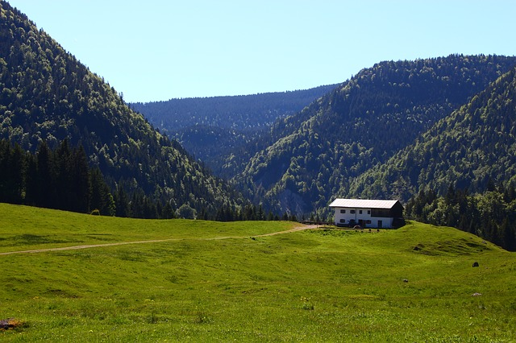
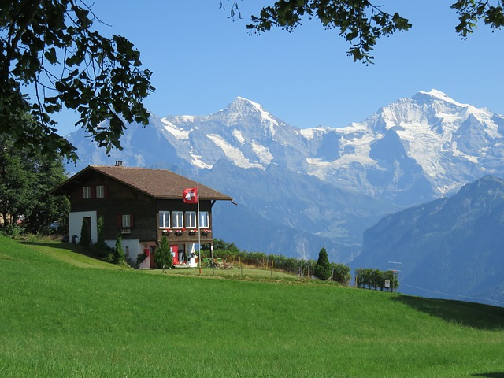
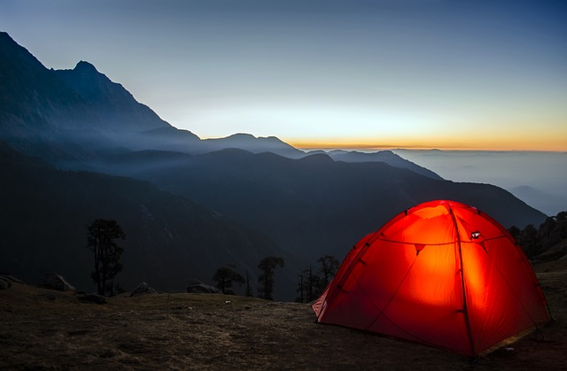

# Accommodation for hikers

A selection of reference information on how to find and book accommodation.

## Hotels and apartments

The best-known sites for finding accommodation

Booking.com - an online hotel booking system, [https://www.booking.com](https://www.booking.com)

[https://www.hostelworld.com/](https://www.hostelworld.com/)- hostels and budget hotels

Airbnb - an online platform for listing, finding and renting private accommodation worldwide. [https://airbnb.com/](https://ru.airbnb.com/)

[https://www.couchsurfing.com/](https://www.couchsurfing.com/)- a service for finding free accommodation with local residents worldwide.

TripAdvisor offers real reviews by travelers about hotels, restaurants and attractions [https://www.tripadvisor.com](https://www.tripadvisor.com/) -- a popular portal worldwide.

Hotel comparison sites that search across booking portals:

[https://www.roomguru.ru/](https://www.roomguru.ru/)

[https://www.trivago.ru/](https://www.trivago.ru/)

## Camping

[https://camping.info](https://camping.info/) Here you will find 23,019 campsites in Europe (as of May 2019), which you can rate.

## Mountain huts

 [Image by Ale Bah from Pixabay](https://pixabay.com/photos/alm-mountain-alpine-austria-hut-2721842/)

> A mountain hut (also known as alpine hut, mountain shelter, mountain refuge, mountain lodge, and mountain hostel) is a building located high in the mountains, generally accessible only by foot, intended to provide food and shelter to mountaineers, climbers and hikers. Mountain huts are usually operated by an Alpine Club or some organisation dedicated to hiking or mountain recreation. Mountain huts can provide a range of services, starting with shelter and simple sleeping berths. Some, particularly in remote areas, are not staffed, but others have staff which prepare meals and drinks and can provide other services, including providing lectures and selling clothing and small items. Mountain huts usually allow anybody to access their facilities, although some require reservations.
> [https://en.wikipedia.org/wiki/Mountain\_hut](https://en.wikipedia.org/wiki/Mountain_hut)

A mountain hut, also called an Alpine hut, shelter, refuge, lodge or hostel (German: Schutzhütte, Berghütte, Schutzhaus; in Switzerland also Hospiz or Ospizio; Italian: Rifugio; French: Refuge), is a solid building providing shelter from bad weather to shepherds, mountaineers, hikers and other travelers in remote mountains. Huts also serve as rescue stations and base camps during mountain rescue operations.

Hut networks are especially extensive along popular hiking and climbing routes in the Alps. Other mountain regions may not have a similarly dense network.

Some huts provide only emergency shelter without facilities. Others have beds, heating, cooking facilities and toilets. Staffed huts may operate as mountain inns (German: Berggasthaus; in Switzerland also Berghaus), usually charge for overnight stays and work seasonally, offering meals for an additional fee.

Many Alpine huts belong to national or regional mountaineering clubs. They generally welcome all travelers, but club members often receive discounts. Reservations may be required.

Unfortunately, there is currently no unified booking system for mountain huts comparable to those for hotels, hostels or campsites. To book an overnight stay, you need to find the hut's contact details and call to arrange it. However, such systems are gradually beginning to appear.

For example:

On the Swiss Alpine Club website: search for mountain huts (only Switzerland) [https://www.sac-cas.ch/de/huetten-und-touren/sac-tourenportal/](https://www.sac-cas.ch/de/huetten-und-touren/sac-tourenportal/)

On the Austrian Alpine Club website (Austria, Germany, Italian Tirol) [https://www.alpenverein.at/huetten/finder.php](https://www.alpenverein.at/huetten/finder.php)  
 [Image by Stefanie Laubscher from Pixabay](https://pixabay.com/photos/alpine-mountains-panorama-1024932/)

## Camping independently

Generally, you can stay in your tent at designated campsites in any country. There is a fee, but it is usually much cheaper than staying in a hotel. The possibility of camping outside designated campsites depends greatly on the country and region. In Central Europe it is generally discouraged, although it is sometimes permitted above the tree line. In Norway, for example, the laws are more liberal. For more specific information, ask at regional tourist offices.  
 [Image by anurag kaushik from Pixabay](https://pixabay.com/photos/camping-travel-sunrise-adventure-2581242/)

Video lecture: "Independent camping trips in the Alps: Kovinov online!" (Russian).
