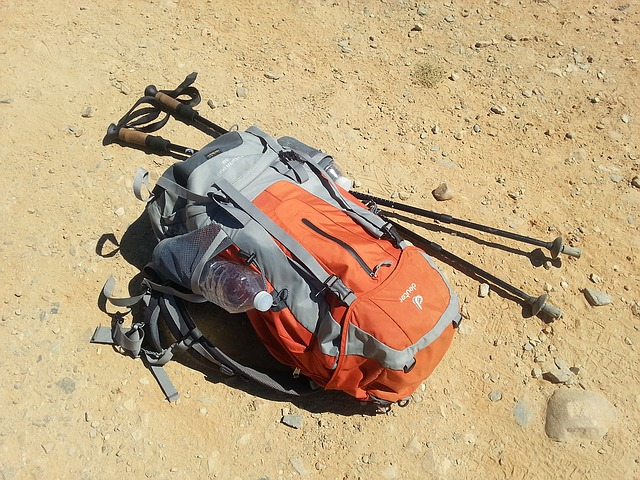
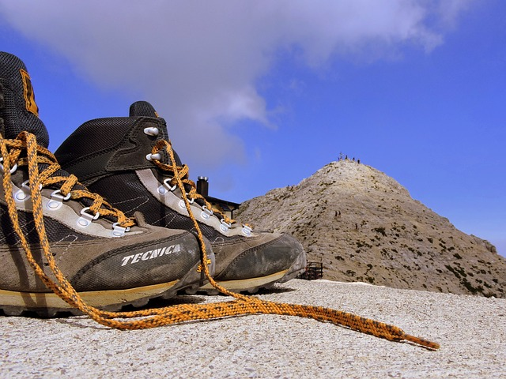
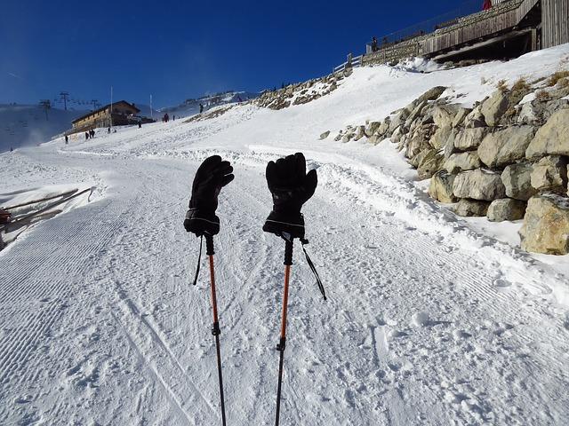

# About tourist equipment

One advantage of hiking is that its equipment is affordable. Compared with other sports, the initial cost of essential items is low: good boots, suitable clothing and a comfortable backpack are enough to get started. If you want to buy more, a large industry offers hiking goods and equipment from brands around the world.

Generally speaking, consumerism is foreign to the spirit of hiking, which values freedom from the constraints and stereotypes of civilization, naturalness and closeness to nature. Still, we should not take this to extremes by dismissing the work of the hundreds of thousands of people who make hiking equipment. They work not only for profit, but also for self-realization and progress, contributing their labor and talent for our benefit.

If your finances allow, shopping for hiking equipment can be another source of inspiration. Limited funds, however, need not prevent you from hiking: the simplest outings require no special equipment.

 [Image by rggroning from Pixabay](https://pixabay.com/photos/backpack-camino-camino-de-santiago-1062702/)

The basic equipment for a day hike is:

* Backpack
* Footwear
* Protection against a rain

For overnight hikes, add:

* Tent
* Sleeping bag
* Tourist rug or inflatable mattress
* Tourist complete sets for cooking. And about food and water also it is not necessary to forget :)

Additional equipment for either type of hike can include:

See also "Ten Essentials" in ["Rule"](rules) section

* trekking poles
* Additional warm clothes, including thermal underwear, gloves and a warm hat
* Protection against the sun. Sun glasses, a sun-protection cream for lips and a skin, a hat, clothes for protection against the sun.
* Navigation means. An electronic topographic map on the smart phone, the portable navigator or other electronic device. A paper topographic map and various maps in the water-proof container, and also a magnetic compass, an optional altimeter or the GPS-receiver.
* Illumination. A headlight, a small lamp, accumulators. The light-emitting diode lamp is preferable to prolongation of a lifetime of the battery.
* First aid subjects (the first aid first-aid set), and also means from insects.
* Fire. A butane lighter, matches in water-proof container.
* The repair complete set and tools. Knives, the multipurpose tool, scissors, flat-nose pliers, a screw-driver, a trowel/shovel, a sticky tape, cable couplers.
* An ice axe for travel on a glacier or a snow field (if necessary)
* Signalling devices, such as a whistle, a mobile phone, a bilateral radio communication, satellite phone, an unbreakable alarm mirror or flash, a laser pointer.
* Etc.

Because equipment manufacturers have an interest in advertising their products, you can find many professional reviews, comparisons and test reports online (see the links in each section and at the end of this page). Without claiming to cover the subject fully, we offer a few basic tips on choosing hiking equipment.

## Hiking backpack

The main rule when choosing a backpack for light hiking is simple: it should hold everything you plan to take. Gather your rain protection, warm clothing, food and at least a litre of water in advance to estimate the volume you need. Some people even recommend taking the whole kit to the outdoor shop.

A second important factor, even for easy hikes, is a backpack's water resistance. There are several approaches:

* A waterproof backpack with stitched, sealed and protected seams. Unlike a jacket or boots, a backpack usually does not need to "breathe", so there is a wider choice of materials.
* A backpack made from any material, preferably partly water-resistant, with a separate waterproof cover.
* A backpack made from any material, preferably partly water-resistant, with a rain poncho designed to fit over both you and the backpack.
* A backpack made from any material, preferably partly water-resistant, with all contents carefully packed in waterproof bags. This is the least desirable option on its own, but waterproof packaging for valuables is useful in any case.

For more demanding hikes with a heavy backpack, the suspension system becomes especially important. Pay attention to the design and fit of the hip belt. A correctly fitted pack transfers most of the load to your hips rather than your shoulders. A rigid back frame is also useful.

Recommendations about volume of a tourist backpack

|           Duration of a campaign           | Backpack volume, l |
|--------------------------------------------|--------------------|
| For one day or with one spending the night | 20-50              |
| 2-3 days                                   | 50-60              |
| 3-5 days                                   | 60-80              |
| From a week and more                       | From 80            |

Finally, consider pockets, compartments, ease of access and attachments for items such as water bottles, trekking poles or an ice axe. Hip-belt pockets are useful for small items you need frequently on the trail. If neither the backpack nor your clothing has suitable pockets, a waist bag can make up for their absence. This is especially useful for light hiking, as small backpacks often have no hip belt.

**References:**

The Ultimate Guide to Choosing the Best Travel Backpack 2018 [https://www.wheressharon.com/x-featured-discussions/best-travel-backpack/](https://www.wheressharon.com/x-featured-discussions/best-travel-backpack/)

## Hiking footwear

For light hiking, ordinary sports shoes or simple hiking boots may be suitable. Simpler footwear is often more versatile and can also be worn outside hikes, saving money. Several factors may call for more specialized footwear:

* Difficult terrain. On rocky mountain trails, sturdier boots help protect your feet and the boots themselves from side impacts. On wet surfaces, especially rocks, footwear needs good wet-surface grip.
* Hikes with a heavy backpack. Sturdier hiking boots are preferable.
* People with physical limitations, limited fitness or excess weight should choose footwear individually and consider specialized hiking footwear. For example, higher boots offer some ankle protection when there is a risk of sprains from previous injuries. Anatomical insoles may be important for people with flat feet.

 [Image by Gianni Crestani from Pixabay](https://pixabay.com/photos/boot-mountain-top-carega-refuge-1632050/)

The standard classification of hiking footwear

* Light trekking or hiking boots: for simple routes and weekend hikes with a backpack weighing no more than 15 kg.
* Classic "midweight trekking boots": for longer routes at elevations up to 3,000 m, with a moderately heavy backpack weighing up to 25 kg.
* "Heavy backpacking boots": for demanding mountain routes and multi-day hikes over difficult terrain in changing weather, with a backpack weighing more than 25 kg.

Tips for buying boots

* Do not buy boots immediately before a hike: allow time to get used to them and break them in.
* Avoid buying boots without trying them on, for example online, unless you have sufficient experience with such purchases.
* Buy footwear from a shop that allows exchanges if the size or fit is unsuitable
* Prefer a roomier fit to a narrow one, as feet can swell during prolonged walking. Your foot should still be held securely in the boot.
* Try on boots in the evening, when your feet are slightly larger, to approximate their condition on the trail.
* Try boots with different socks, both thick and thin, intended for different weather conditions.
* Your toes should not touch the front of a firmly laced boot. To check the available space, loosen the laces and slide your foot forward until your toes touch the front. The gap behind your heel should be 0.5–1 cm for light and medium trekking boots, or 1–1.5 cm for heavy boots.
* Anatomical insoles can partly compensate for a slightly loose fit.

Water resistance of boots.

Water resistance is important for hikers because a full day outdoors increases the chance of being caught in rain. Dew on grass, boggy ground and snow can also wet your boots. However, the more waterproof a boot is, the less well it tends to breathe, leading to increased sweating. You need to find a reasonable compromise.

One option is membrane technology, such as GORE-TEX. It helps keep feet dry and comfortable by preventing water from entering while allowing some moisture to escape. Even so, membrane boots breathe less well than permeable materials. The membrane is usually a thin inner layer that wears during walking, reducing water resistance. Incorrect drying, for example beside a fire, can damage the membrane and seal the pores of the synthetic material, leaving the boots unable to breathe (the good news is that they then become completely waterproof :)).

**References:**

How to Choose Hiking Boots [https://www.rei.com/learn/expert-advice/hiking-boots.html](https://www.rei.com/learn/expert-advice/hiking-boots.html)

## Hiking clothing

Clothing is usually considered in layers:

* Inner layer: underwear and thermal underwear. The main purpose of thermal underwear is to wick away moisture, rather than directly provide warmth; this helps keep you warm indirectly.
* Middle layer: insulation, such as a sweater, fleece or second layer of thermal clothing.
* Outer layer: protection from rain and wind.

The three layers need not be separate garments, because their functions can be combined. For example, a jacket can provide both weather protection and insulation. Some relatively expensive two-layer thermal garments combine moisture wicking and warmth.

## Good advice

> About ultralight equipment. I love lightweight gear. The lighter your backpack, the less energy you expend and the more you have left to look around and admire nature. After all, that is why we go to the mountains, rather than to "die under a backpack"! But every kilogram or gram saved comes either at the expense of reliability or through more advanced and expensive materials. There are no miracles. Is there an optimum in this race to reduce equipment weight? Everyone has their own answer, which, in my experience, depends on more than finances. Is it worth paying five thousand roubles more for a sleeping bag that is 500 grams lighter? Or three thousand more for light, durable trainers instead of cheap pseudo-sports brands? It depends on how much you value your comfort and are willing to spend on your passion for mountains. Unfortunately, there is no limit to enthusiasm. My goal for next summer is to go on multi-day mountain hikes with a backpack weighing no more than 10–12 kg, and I am willing to spend money to achieve it. Decide for yourself where to stop!
> D.Kovinov [http://www.kovinov.com/europe/alpy/snarjazhenie/](http://www.kovinov.com/europe/alpy/snarjazhenie/)

 [Image by Hans Braxmeier from Pixabay](https://pixabay.com/photos/gloves-cold-warming-black-ski-run-81377/)

## References

Hiking equipment [https://en.wikipedia.org/wiki/Hiking\_equipment](https://en.wikipedia.org/wiki/Hiking_equipment)

 [Image by anurag kaushik from Pixabay](https://pixabay.com/photos/camping-travel-sunrise-adventure-2581242/)
