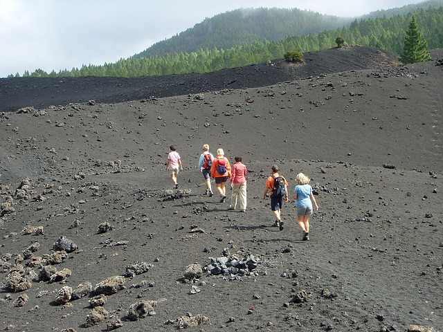
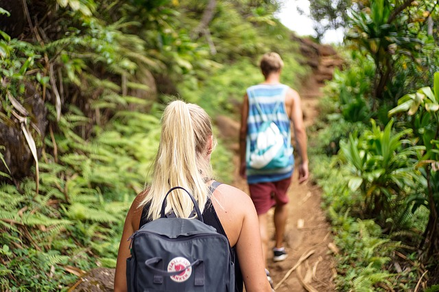
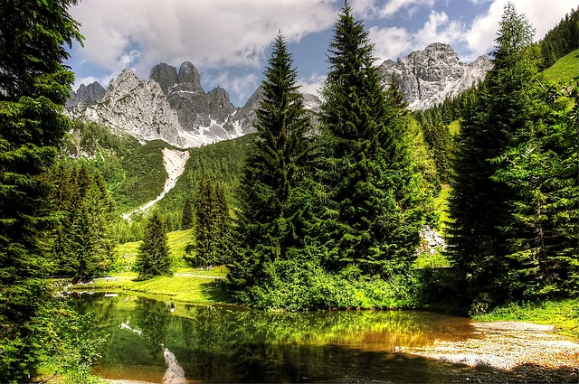
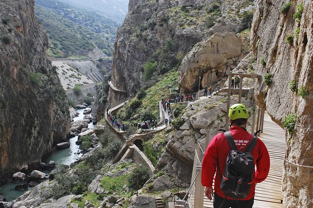
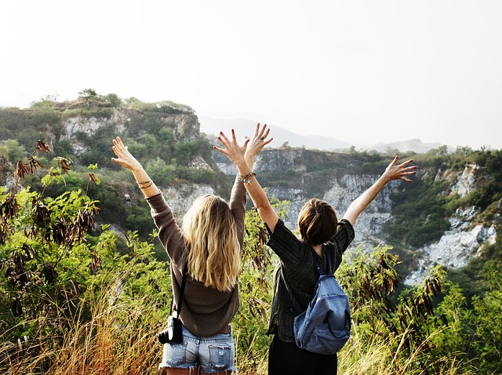
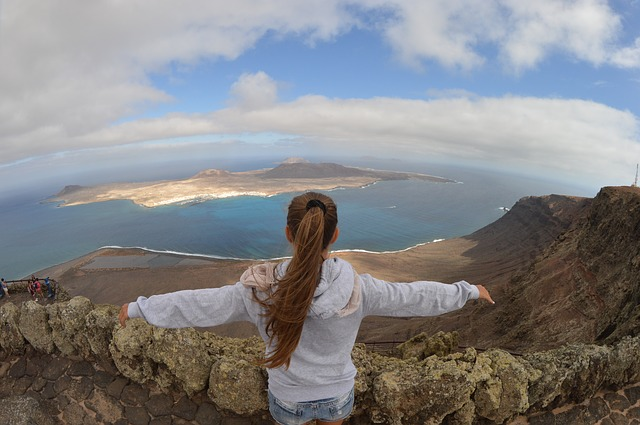
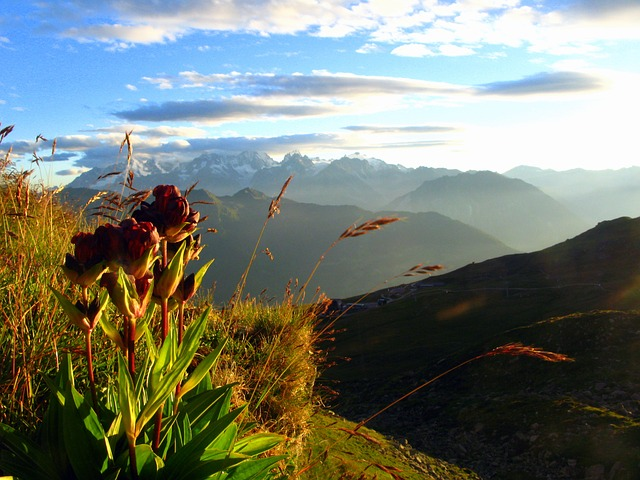

# Hiking

## The basic idea of hiking

What attracts people to hiking? Why is it so popular around the world? The answer seems obvious: hiking is simple. You need neither special equipment nor special skills to get started. You do not have to travel far from home, because hiking opportunities exist almost everywhere. Hiking has a low barrier to entry, including financially. Is simplicity the whole explanation? Yes and no. That answer would be too superficial. We know many people who have plenty of opportunities for distant and varied travel, yet choose hiking again and again. Why? There must be other reasons that attract people to this activity.

It is interesting to hear from hikers themselves. We present a selection of interviews with people who love hiking, in which they explain the reasons for their enthusiasm. Before reading, try answering the question yourself. Then compare your answers with those below. You may feel a connection with the authors, who, like you, belong to a huge community of hikers. If your answer is missing from the selection, or you have an interesting story about your own experiences, write to us and we will try to expand this section.

 [Image by Bernd Hildebrandt from Pixabay](https://pixabay.com/photos/hike-lunar-landscape-tenerife-663337/)

**So, what attracts different people to hiking?**

Hiking gives us a wonderful opportunity to appreciate the vastness and variety of nature. It lifts our spirits and makes us grateful for our existence. It connects us with the nature from which we emerged and of which we are a part. Hiking is also an excellent way to spend a day in nature: a small weekend adventure that lets you escape the bustle of the city and feel refreshed by Monday morning.

 [Image by Foundry Co from Pixabay](https://pixabay.com/photos/hike-hikers-scene-climb-boyfriend-863454/)

One attraction of hiking is the freedom from having to fill every silence with words. You do not need to say anything when you lie under the stars or look into a deep mountain gorge. You simply feel a sense of wonder, vastness and meaning.

Hiking lets you see breathtaking landscapes that you cannot find in a city or see from a car: mountains, lakes, waterfalls, sunrises and sunsets. If you enjoy photography or filming, hiking will be especially interesting to you.

A connection with reality. On a hike you smell nature rather than other sweaty people in a gym. Many people find an uneven dirt trail more appealing than a paved sidewalk. For those who prefer the real thing, an elliptical trainer or treadmill will always be a poor imitation of what nature offers for free.

A sense of achievement is a key part of mountain hiking. Climbing a steep mountain reminds you of your own spirit of adventure.

A feeling of autonomy. You can carry everything you need for daily life, travel, meals and overnight stays. Test your ability to cook, set up your temporary home, keep yourself and your clothes clean, and use [a map](maps), a compass or GPS to find your way and feel comfortable in different conditions.

 [Image by kordula vahle from Pixabay](https://pixabay.com/photos/almsee-schladming-lake-nature-3507818/)

Self-sufficiency, confidence and a sense of accomplishment. The more time you spend hiking, the sharper your skills become. You become a true adventurer. You learn to recognize weather conditions, read the terrain and understand what your body needs to perform well. Your equipment becomes more efficient, and you learn to get more out of it at less expense. You can travel in different seasons and conditions — snow, rain, mountains or desert — for longer periods and enjoy doing so. Growing confidence makes hiking more enjoyable. On a hike, everything you need to survive is in your backpack, your pockets or, of course, your head. This fills you with enthusiasm and positive energy.

Hiking lets you experience "open space" in both a literal and a metaphorical sense. The feeling depends on where you travel, but places where you see only a few people on a hike are accessible to everyone. In remote areas or outside the main season, you may see nobody at all. This physical space can have a peaceful, refreshing effect. The absence of noise and crowding also lets your mind wander and think differently. It is no coincidence that creative people have made many enjoyable and productive discoveries while walking.

 [Image by guillermo gavilla from Pixabay](https://pixabay.com/photos/caminito-del-rey-malaga-adventure-2227526/)

On a hike, you make repetitive movements, simply putting one foot in front of the other. Under certain conditions, this rhythm, combined with the surrounding landscape, helps create a positive, creative mental space that differs from everyday life. Runners, rowers and climbers are said to experience something similar when they enter a "flow state". This offers a chance to look at your everyday self, occupied with daily tasks and concerns, from the outside. This is particularly relevant for people who live far from the countryside.

Hiking is good for your health. It helps you stay physically active and may help you lose weight, reduce the risk of heart disease, lower blood pressure and slow aging. It can also improve mental health by reducing stress and anxiety. Hiking can help prevent depression, ease tension and improve your fitness.

 [Image by rawpixel from Pixabay](https://pixabay.com/photos/freedom-travel-hiking-together-2768515/)

 [Image by Nicolò Anastasio from Pixabay](https://pixabay.com/photos/freedom-fly-dream-empty-infinite-1681696/)

Socializing. Sometimes we want to be alone on the trail; at other times we enjoy meeting people and making friends. These encounters are especially pleasant when you spend most of a hike alone or in a small group. Meeting old acquaintances by chance is an extra gift.

Walking is simple: the barrier to entry for beginners is low. You can control the intensity of your exercise and find a pace that suits you. Compared with many other outdoor activities, hiking requires only a few simple items of equipment and [practical skills that are easy to learn](rules).

Bonus: hiking can be inexpensive. Compared with many other sports, the initial cost of essential equipment is low. All you need as a basic kit is a pair of good boots, suitable clothing and a comfortable backpack. If you want to buy more, a large industry offers hiking goods and [equipment](equipment) from brands around the world.

## Other activities to enjoy on a hike

* Orienteering
* Geocaching (game with application of the satellite navigating systems, consisting in a finding of the hiding places hidden by other participants of game)
* Mountaineering, rock-climbing
* Paragliding
* Photography
* Wildlife watching
* Fishing
* Berry picking
* Etc.

 [Image by Florence D. from Pixabay](https://pixabay.com/photos/alps-flower-mountain-ski-light-2947165/)

**Sources used:**

* What makes hiking so fun? (What makes hiking so interesting?) - a selection of interviews [https://www.quora.com/What-makes-hiking-so-fun](https://www.quora.com/What-makes-hiking-so-fun)
* "Short pitch on hiking" Video lecture. [https://www.youtube.com/watch?v=OyjV7x6IhDE](https://www.youtube.com/watch?v=OyjV7x6IhDE)
* Feeling of "achievement" of top (sense of achievement) a photo selection on these keywords, the best photo - [http://michellegielan.com/psychology-today-how-to-go-from-i-think-i-can-to-i-know-i-can/achievement-goal-mountain/](http://michellegielan.com/psychology-today-how-to-go-from-i-think-i-can-to-i-know-i-can/achievement-goal-mountain/) (from a site Michel Gilan -- the American author of books on happiness psychology)
* Than still it is possible to be engaged in campaigns to make their even more interesting. [https://www.thoughtco.com/fun-activities-for-hikers-1766200](https://www.thoughtco.com/fun-activities-for-hikers-1766200)
* Various materials found on the Internet
