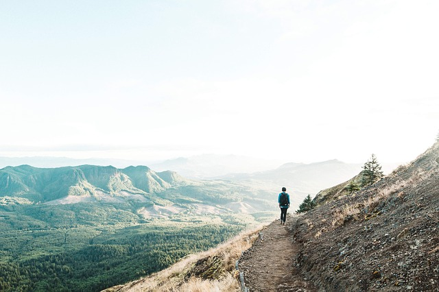
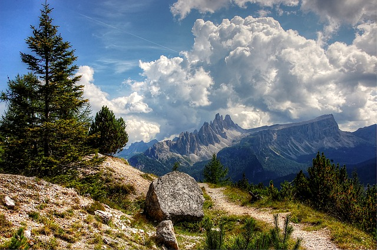
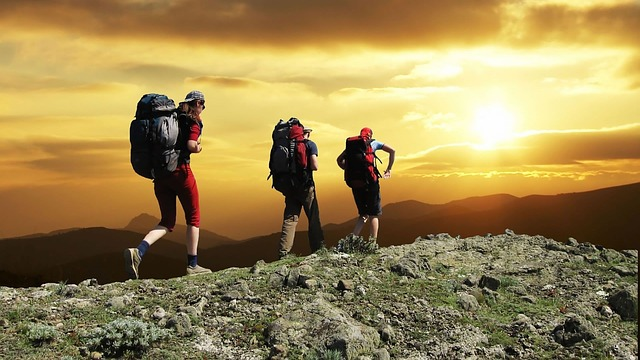

# The world of hiking

Our project is about the world of hiking (trekking, backpacking, etc. — see the section ["Terminology"](terms)). We offer some [inspiring materials](hiking) explaining why this activity is so popular. Our main goal is to help beginners discover this remarkable world of physical activity. Here you can find reference and technical information to help you choose a destination, plan your trip and prepare for it. Experienced travelers may also find our project interesting.
 [Image by Pexels from Pixabay](https://pixabay.com/photos/adventure-hike-hill-landscape-1851262/)

Hiking gives us a wonderful opportunity to appreciate the vastness and variety of nature. It lifts our spirits and makes us grateful for our existence. It connects us with the nature from which we emerged and of which we are a part. Hiking is also an excellent way to spend a day in nature: a small weekend adventure that lets you escape the bustle of the city and feel refreshed by Monday morning.

One attraction of hiking is the freedom from having to fill every silence with words. You do not need to say anything when you lie under the stars or look into a deep mountain gorge. You simply feel a sense of wonder, vastness and meaning.

Hiking lets you see breathtaking landscapes that you cannot find in a city or see from a car: mountains, lakes, waterfalls, sunrises and sunsets. If you enjoy photography or filming, hiking will be especially interesting to you.

 [Image by kordula vahle from Pixabay](https://pixabay.com/photos/croda-da-lago-dolomites-italy-3573170/)

A sense of achievement is a key part of mountain hiking. Climbing a steep mountain reminds you of your own spirit of adventure.

Hiking lets us enjoy a feeling of autonomy. You can carry everything you need for daily life, travel, meals and overnight stays. Test your ability to cook, set up your temporary home, keep yourself and your clothes clean, and use [a map](maps), a compass or GPS to find your way and feel comfortable in different conditions.
**The short guidebook to site materials**

The theoretical and inspiring information is in the theory section: [hiking](hiking) and [terminology](terms).

Information about selected tourist destinations is in [Regions](places/list) (currently covering the countries of Alpine Europe).

Reference and technical information is in [Cartography](maps) (online maps, GPS tracks, devices and software), [Transport](trafic) (planes, trains and cars), [Booking](booking) and [Equipment](equipment). Also see [Hiking rules](rules) (time estimates, safety and common beginner mistakes) and [Alpine clubs](alpenverein).

 [Image by skeeze from Pixabay](https://pixabay.com/photos/hikers-mountain-sunset-hiking-1147796/)

Additional sections include [Related](around) (interests and lifestyles related to tourism: nudism, naturism, hippies and hermits), [Image Gallery](gallery/gallery), [Films about tourism](media/list) and [Links catalogue](links).
