# Cartography (maps)

In our view, maps are a hiker's main tool for planning and inspiration. They can also be used for entertainment :).

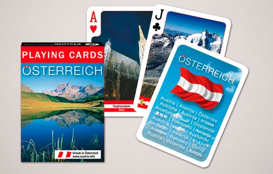

Below is an overview of popular mapping resources and tools. We focus on digital tools, but every hiker should still carry a paper map: its battery will never run out and let you down when you need it most.

[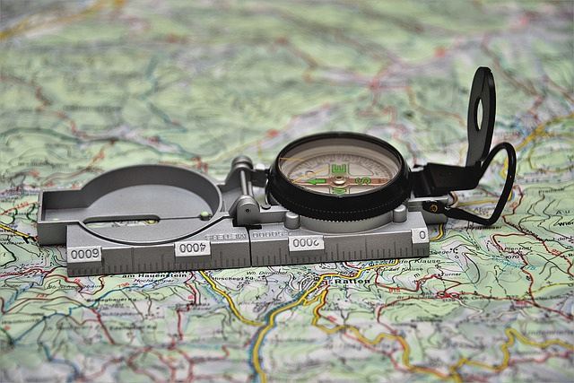](../images/pixabay/compass-3072364_1280.jpg) [Image by PixLord from Pixabay](https://pixabay.com/photos/compass-hiking-outdoor-travel-3072364/)

Within each section, tools are ordered by their popularity and usefulness for hikers, in our view.

## Our video channel

Our [video channel](https://www.youtube.com/channel/UCsYA-4VXxbKB0lWMxkLoxFQ) includes lectures about mapping.

Planning walking routes with electronic maps: Google Maps, Google Earth, OpenStreetMap, Wikimapia, Wikiloc, Kompass Karten, Bergfex and others (Russian).

## Paper maps

Paper topographic maps can be purchased in bookshops, kiosks at stations and airports, local tourist offices and hotels.

Kompass Karten is a respected publisher of maps for the Alpine region. Based in Innsbruck, Austria, it specializes in hiking maps and guides, digital maps, and cycling maps and guides.

KOMPASS has about 1,000 titles in its programme, including 700 hiking, cycling and ski touring maps. Just under 500 hiking maps have been published covering the hiking areas of Austria, South Tyrol, Germany, the Balearic and Canary Islands. Hiking regions in the rest of Italy, the Swiss Alps, the Czech Republic and Slovakia have some coverage. The maps are mainly published at a scale of 1:25,000 or 1:50,000, with trails, footpaths and additional tourist information highlighted. The new generation of hiking maps is printed with a coordinate grid for GPS navigation. Since mid-2011 weatherproof and rip-resistant maps have been printed, gradually replacing the existing maps.

KOMPASS-Verlag has just under fifty digital maps in its range, covering the whole of Austria, several walking areas in Germany, South Tyrol, the Canaries, the Balearics, Malta and Elba. The digital maps are usable on PDAs and mobile phones using Java technology for outdoor navigation. The map material is at a scale of 1:50,000 zoomable to 1:10,000.

Since 2009 there has been a cycling map series at a scale of 1:70,000. In 2011 a cycling guide series appeared. Both are printed on rip-resistant and weatherproof paper.

The company also publishes hiking atlases, nature guides, panoramas, cookery books and ski tour guides.

**References on a theme:**

Interesting, though also a little out-of-date research in which various foot maps for one concrete Alpine area (Grande Traversata delle Alpi) [https://klingenfuss.org/drim\_lit.htm#karten](https://klingenfuss.org/drim_lit.htm#karten).

## Online maps

### Google Maps

The service provides maps and satellite images of Earth. It is currently the most popular online map service. [https://www.google.ru/maps/](https://www.google.ru/maps/)

### OpenStreetMap

OpenStreetMap (OSM) is a collaborative project to create a free editable map of the world. Rather than the map itself, the data generated by the project is considered its primary output. The creation and growth of OSM has been motivated by restrictions on use or availability of map information across much of the world, and the advent of inexpensive portable satellite navigation devices.\[6\] OSM is considered a prominent example of volunteered geographic information. [https://www.openstreetmap.org/](https://www.openstreetmap.org/)

### kompass.de

[http://www.kompass.de/](http://www.kompass.de/)

Kompass Karten is an Austrian map publisher based in Innsbruck. It specializes in hiking maps and guides, digital maps, and cycling maps and guides. Its range includes more than 1,000 titles.

The publisher specializes in paper maps and also offers desktop software and a free website with online maps. [http://maps.kompass.de/](https://www.kompass.de/wanderkarte/) (in German). Unfortunately, there is no offline mode. Desktop software is available, but its maps must be purchased.

Example of a screenshot with the map, made from this site.

[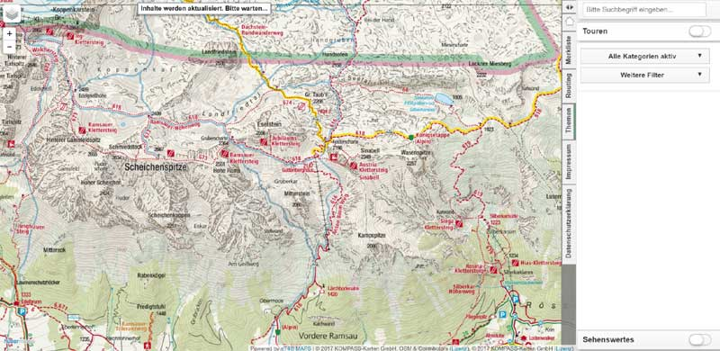](../images/kompass_example.jpg)

### Wikimapia

Wikimapia is a free international website and online geographical encyclopedia that aims to mark and describe all geographical objects on Earth. It combines an interactive map with freely editable wiki content. [http://wikimapia.org/](http://wikimapia.org/)

[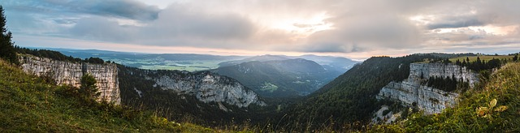](../images/pixabay/creux-du-van-2839090_1280.jpg)

### Yandex.Maps

Yandex.Maps is Yandex's mapping and geographic search service, launched in 2004. It offers map search, traffic information, route planning and street panoramas. [https://yandex.ru/maps](https://yandex.ru/maps)

### Wandermap

The interactive map with the user foot routes (worldwide, but the greatest quantity in Europe) [http://www.wandermap.net/](http://www.wandermap.net/)

### Bergfex

[https://www.bergfex.com/](https://www.bergfex.com/)

Bergfex.at is an Austrian online platform for mountaineering and Alpine sports, the largest in Europe in this sector.

The site covers more than 1,700 ski resorts in twelve European countries and 525 tourist regions in seven countries. It offers destination information, lift operating hours, accommodation, snow and weather reports, detailed maps, webcam links and other information for excursions and holidays. It also describes hiking and cycling routes, ranging from family walks to challenging tours, as well as local attractions. The portal is available in 18 languages (bergfex.at, bergfex.ch, bergfex.de, bergfex.it, bergfex.fr, and others).

For example, page with an interactive Austria map [https://www.bergfex.com/sommer/oesterreich/](https://www.bergfex.com/sommer/oesterreich/)

[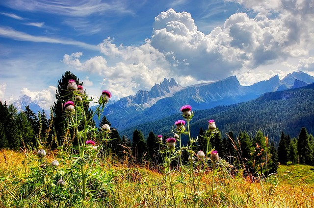](../images/pixabay/croda-da-lago-3514017_1280.jpg) [Image by kordula vahle from Pixabay](https://pixabay.com/photos/croda-da-lago-tofane-dolomites-3514017/)

### nakarte.me

[https://nakarte.me/](https://nakarte.me/) (formerly nakarte.tk) aggregates mapping services. Created by hikers for hikers, it helps plan walks and mountain traverses. Project documentation and instructions: [https://docs.nakarte.me/](https://docs.nakarte.me/).

### Other online services

[https://www.schweizmobil.ch/en/summer.html](https://www.schweizmobil.ch/en/summer.html) Maps of Switzerland

[http://www.freizeitkarte.at/](http://www.freizeitkarte.at/freizeitkarte.php?gebiet_id=62&type=gebiet) the Site (in German) with the interactive appendix (on the basis of Adobe Flash - it is tested in FireFox) on several Alpine regions. At an input on a site it is necessary to choose region from the list. After that the corresponding site will open. Further it is necessary to start by means of the navigation menu passage any of routes available on a site. After that the route will be stage by stage shown on 3D the district image.

The interesting map -- population density in the world. [https://pudding.cool/2018/10/city\_3d/](https://pudding.cool/2018/10/city_3d/)By means of the given map it becomes clear, why in Europe the Alps are the most interesting place for hiking.

[https://earthengine.google.com/timelapse/](https://earthengine.google.com/timelapse/) the Service, allowing to see, how the satellite picture of a certain place for last 30 years has changed.

[https://www.strava.com/](https://www.strava.com/) Strava - service for tracing of activity of sportsmen by means of mobile devices. Service includes appendices for mobile devices, an Internet site, a database of the preserved trainings, API for access to them and other subsystems. Strava also it is positioned as a social net for sportsmen where they can compare the results, put the purposes, communicate and etc. service Working out it is led by company Strava, Inc which has been based in 2007; its basic office is in San Francisco, California

[https://www.relive.cc/](https://www.relive.cc/)allows to connect the account Strava (Relive works with Strava, Endomondo, Garmin Connect, Apple Health (Watch), MapMyRun, MapMyWalk, MapMyRide, MapMyHike and Polar Flow) and to create 3D video from a track of your employment. Relive transforms your adventure into personal video which should share. Fly by over the route, look, where you were, and look at your high lights!

[http://www.etomesto.ru/](http://www.etomesto.ru/) On EtoMesto.ru you can look and compare old maps online and impose them on the modern. On a site ancient Moscow maps and Moscow Region, St.-Petersburg and Leningrad region, and also other regions of Russia are introduced. The territory of Ukraine, Belarus, Moldova, Kazakhstan, the countries of Baltic and caucasus is a little captured also.

### Reviews and selections

Interesting mapping services (Russian): [https://trekkingmania.ru/samyie\_interesnyie\_kartograficheskie\_servisyi/](https://trekkingmania.ru/samyie_interesnyie_kartograficheskie_servisyi/)

Alpine maps: an article from the Nizhny Novgorod hiking club (Russian). [http://www.trekkingclub.ru/alpin/pohodmap.htm](http://www.trekkingclub.ru/alpin/pohodmap.htm)

## GPS tracks

[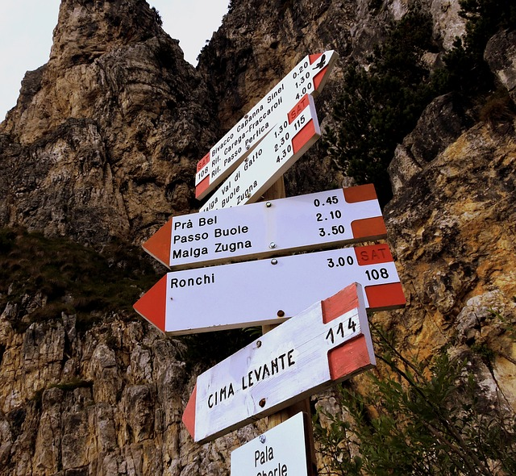](../images/pixabay/crossroads-1595989_1280.jpg) [Image by Gianni Crestani from Pixabay](https://pixabay.com/photos/crossroads-mountain-hiking-rock-1595989/)

A track is a sequence of GPS coordinates with timestamps. It is usually recorded by a navigation device or software on a computer or smartphone. As someone walks a route with the device switched on, it saves their coordinates to a file. You can load that track into your own device or software to follow the same route. Public online repositories let you view and download tracks shared by users, or upload your own to share with the hiking community.

When following a track, remember that it may not match the best route or existing trails and roads. The person who recorded it may have left the trail or become lost for a while. Trails, especially mountain trails, may also have changed over time. Keep all of this in mind.

In any case, studying other people's tracks is useful when planning a route.

[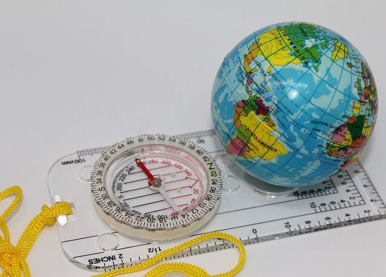](../images/pixabay/globe-2707935_1280.jpg) [Image by bluebudgie from Pixabay](https://pixabay.com/photos/globe-compass-travel-geography-2707935/)

Tracks come in various formats, and many modern devices and programs support several of them. If necessary, you can use software to convert between formats.

Popular formats are: GPX (GPS eXchange Format), TCX, KML and KMZ (Google Earth), PLT (a format of program OziExplorer), GDB (Garmin Mapsource)

### How to write down GPS tracks

Recording and using GPS tracks: [https://ichip.ru/zapisyvaem-i-ispolzuem-gps-trek.html](https://ichip.ru/zapisyvaem-i-ispolzuem-gps-trek.html).

The instruction on record of tracks from openstreetmap for the subsequent loading in this project [https://wiki.openstreetmap.org/wiki/Recording\_GPS\_tracks](https://wiki.openstreetmap.org/wiki/Recording_GPS_tracks)

### Where to search, look and download. Storehouses of GPS tracks

[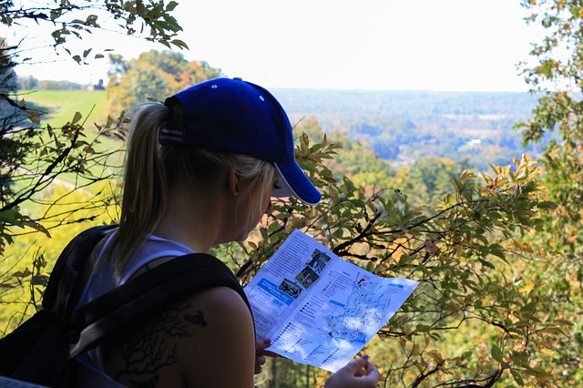](../images/pixabay/hike-467875_1280.jpg) [Image by Kelsey Vere from Pixabay](https://pixabay.com/photos/hike-trek-map-navigation-travel-467875/)

#### Wikiloc - World Footpaths

The most known storehouse GPS of tracks. The data from it uses Google Earth. On our site you can find on page of each region the reference for transition to site Wikiloc on which the map with display GPS of tracks of the given area will open.

Official site [https://wikiloc.com/](https://ru.wikiloc.com/)

On 03.2019 on Wikiloc 4 436 675 participants were registered, 11 234 084 tracks and 19 788 477 photos are added. There are appendices for iPhone and Android. The expanded functions are accessible for Premium an account. Since 2008 it is used Google to show tracks as a layer by default on Google Earth. There is the Russian interface, one mainly is an English-speaking site.  
The key idea Wikiloc formulated on their site: "We believe in a future where humanity spends more time enjoying and preserving the outdoors. Our goal is to help people have better experiences in community before, during and after outdoor activities and to inspire and support the preservation of nature.".  
You can search by map or region name. To search for a track in Europe, use English place names. For track downloading registration is required. Formats: GPX, TCX, a KML-file (a format for Google Earth), Garmin. You can obtain code to embed track information on a social network or website.

OpenStreetMap recording instructions (Russian): [https://wiki.openstreetmap.org/wiki/RU:Запись_треков_GPS](https://wiki.openstreetmap.org/wiki/RU:Запись_треков_GPS)

#### Other online track repositories

[https://www.openstreetmap.org/traces](https://www.openstreetmap.org/traces) Official storehouse of tracks OpenStreetMap.

Popular GPS-tracks. Viewing of last loaded GPS-tracks. If you at track record went on road, and this road is not present on map OpenStreetMap (OSM) - you can help community, having loaded the track on site OSM.

[https://www.gpsies.com/](https://www.gpsies.com/)a Considerable quantity of tracks worldwide. But objectively it is less than tracks, than in Wikiloc. The Multijazychnyj site. There are appendices for iPhone and Android. A Considerable quantity of formats and additional options for downloading. Downloading is possible without registration. On page a track there are references for introduction on the site.

[https://www.alltrails.com](https://www.alltrails.com) (Everytrail.com)  
From web site: "The beauty of nature doesn't need to be hard to find. Our goal is simple - build the largest collection of hand-curated trail guides, so you can explore the outdoors with confidence. Anytime. Anywhere". Registration is necessary For track viewing.

[https://www.gpslib.ru/](https://www.gpslib.ru/) GPSLib is a public GPS-track library with organization, search and analysis tools. This Russian-language site supports popular GPS/GLONASS formats, including OziExplorer, GisRussa, Navitel, NMEA, Garmin and iGo, and uses Google Maps API V3. It has relatively few walking tracks in Europe, for example around fifty in Austria. Downloads do not require registration.

[https://gpsloglabs.com/](https://gpsloglabs.com/) GPSLog Labs is a Russian-language site for analyzing and comparing GPS-recorded movements, generating charts and reports, and viewing them on a map. It can be used to monitor running, hiking, skiing, cycling and horse riding, or as a daily activity diary. Example user page: [https://gpsloglabs.com/share/0b537c0ebd32b21cdad72138aa4020fa9ef26dc9/](https://gpsloglabs.com/share/0b537c0ebd32b21cdad72138aa4020fa9ef26dc9/). There are almost no European tracks.

## Computers and software

### Software for desktop

#### Google Earth (Google Earth)

Google Earth is a Google project that provides satellite and aerial images of Earth's surface, with exceptionally high resolution in some regions. It presents the planet as a digital globe. As you zoom in, more detailed images appear; their capture dates may vary between areas. Google Earth can also display 3D models of buildings, structures and monuments, including photorealistic models in some cities. Unlike similar services viewed in a browser, this version uses a dedicated program installed on the user's computer. Installation is required, but it offers features that are difficult to implement through a web interface.

There is also paid version Google Earth Plus and the free version Google Earth Pro, different support GPS of navigation, means of presentations and the raised permission of listing. [https://www.google.com/intl/ru/earth/](https://www.google.com/intl/ru/earth/)

[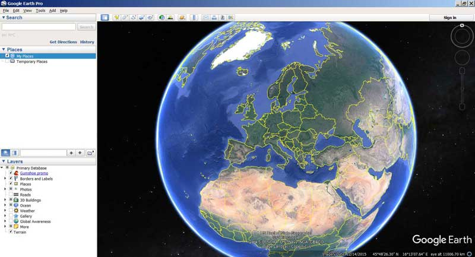](../images/google_earth/main.jpg)

Until mid-2019, there was a Wikiloc track layer in Google Earth, which was quite convenient. However, the collaboration with Wikiloc is now terminated and this layer is not available. For the sake of history, we saved screenshots of how it all looked.

Designation GPS track in program Google Earth

[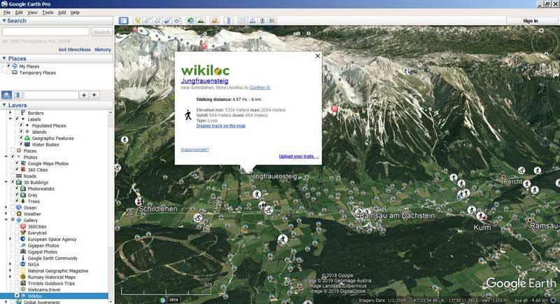](../images/google_earth/wikiloc.jpg)

GPS track in program Google Earth

[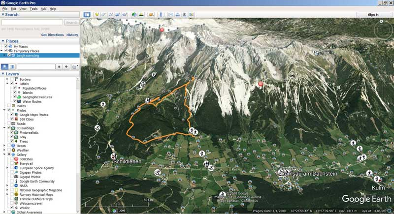](../images/google_earth/track.jpg)

Viewing of photos on the chosen track

[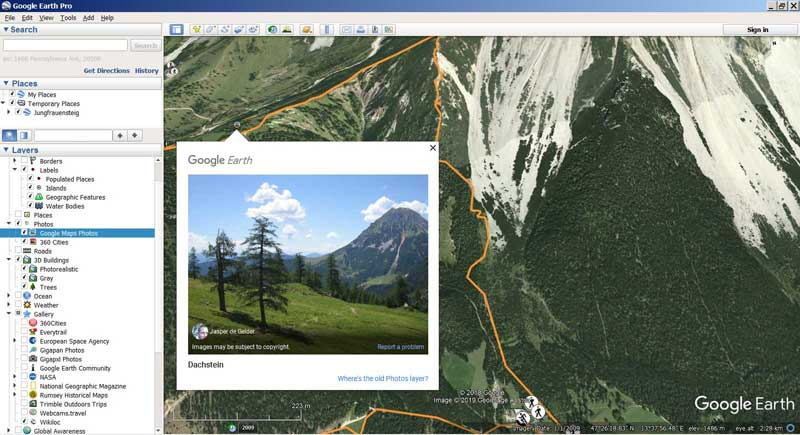](../images/google_earth/foto.jpg)

Links to the page of GPS track in Wikiloc web site

[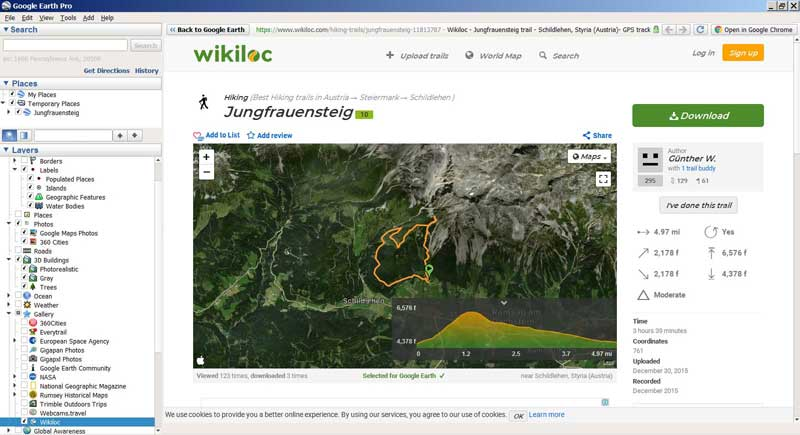](../images/google_earth/trackpage.jpg)

Approach: a mountain track with a GPS track passing along it

[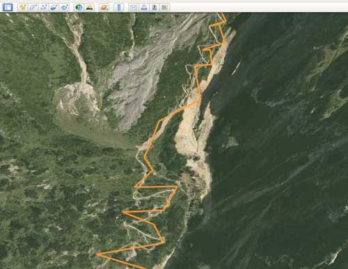](../images/google_earth/track_zoom.jpg)

However, it remains possible to see the track on the map by manually downloading it from Wikiloc and uploading it to Google Earth. For instructions on how to do this, watch a [video lecture](https://www.youtube.com/watch?v=MfClwG_vZ7A) on our video channel. (Russian language. Subtitles: Russian, automatic translation is available for English and other languages)

#### SAS.Planet

SAS.Planet is a free navigation program for downloading and viewing maps and satellite images from online mapping services. Downloaded layers are stored in an offline cache. Data can be downloaded for a selected rectangle, but not for an entire country or administrative area. Other features include saving part of a map as an image, creating georeferencing files for OziExplorer, displaying KML files and Wikimapia objects, adding custom maps and using a GPS receiver for navigation. [http://www.sasgis.org/](http://www.sasgis.org/)

#### GPXSee

GPXSee is a simple, free program for viewing and analyzing GPS tracks, with a Russian-language interface. Tracks are loaded from files, and all tracks in the current directory can be browsed quickly. Supported formats include GPX, TCX, FIT, KML, IGC, NMEA, SLF, LOC, OziExplorer (PLT, RTE, WPT), GeoJSON and Garmin CSV. Background maps can be loaded from files (MBTiles, OziExplorer maps, TrekBuddy maps/atlases, Garmin JNX maps, TwoNav RMaps and GeoTIFF images) or accessed online. [https://sourceforge.net/projects/gpxsee/](https://sourceforge.net/projects/gpxsee/)

#### GPS Track Editor

GPS Track Editor is a free Windows application for working with GPS tracks. You can analyze and clean tracks, organize route segments, view a color-coded path, examine waypoints, extract parts of a track, save GPX, NMEA or CSV files, combine tracks and generate timestamps. [http://www.gpstrackeditor.com/](http://www.gpstrackeditor.com/)

#### OziExplorer

OziExplorer combines raster maps with GPS data. It supports Garmin, Magellan, Lowrance, Eagle, Brunton/Silva and MLR receivers and allows interactive navigation on raster maps. It was formerly one of the most popular mapping applications, especially on Windows CE handheld devices, but has since been displaced by other software. [https://www.oziexplorer4.com/w/](https://www.oziexplorer4.com/w/)

#### GIS "Panorama"

Panorama is a Russian desktop geographic information system for creating and editing digital maps, making measurements and calculations, performing overlays, processing raster data, preparing printed and electronic graphics, and working with databases. It primarily serves government organizations rather than tourism, but may interest mapping enthusiasts. Maps previously had to be obtained separately. The vendor now describes an address database on an open web server that supports object searches while viewing geoportal imagery; we have not tested it. [https://gisinfo.ru](https://gisinfo.ru)

### Software for mobile devices

#### MAPS.ME

MAPS.ME (formerly MapsWithMe) is a free mobile application based on OpenStreetMap. Since November 2014 it has belonged to Mail.ru Group and been developed as part of its international My.com project. Its maps focus more on cities than hiking, but the main trails are marked. [https://maps.me/](https://maps.me/)

#### OsmAnd

OsmAnd (OSM Automated Navigation Directions) is open-source software for offline navigation. Its main data sources are OpenStreetMap vector maps, along with raster maps from services such as Yandex.Maps, Mapnik, Osmarender, CloudMade, Cyclemap, OpenPisteMap, MapSurfer.Net and Microsoft Maps/Earth/Hybrid. [http://osmand.net/](http://osmand.net/)

#### iGO

iGO is GPS navigation software developed by the Hungarian company NNG (formerly Nav'N'Go). Versions are available for Windows CE, Windows Mobile, Apple iOS and, more recently, Android. It uses maps from Tele Atlas, Navteq and local developers, and is primarily intended for car navigation. [http://www.igonavigation.com/](http://www.igonavigation.com/)

[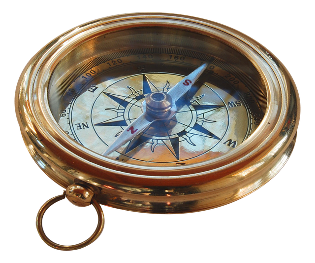](../images/pixabay/compass-3674904_1280.png) [Image by Sunny Sunflower from Pixabay](https://pixabay.com/photos/compass-transparency-cutout-3674904/)

## Additional links

Planning walking routes with electronic maps: Google Maps, Google Earth, OpenStreetMap, Wikimapia, Wikiloc, Kompass Karten, Bergfex and others. The lecture is on our [video channel](https://www.youtube.com/channel/UCsYA-4VXxbKB0lWMxkLoxFQ) (Russian).

"Modern sources of mapping information": a video lecture by Sergey Savelyev, an instructor in youth tourism (Russian).
