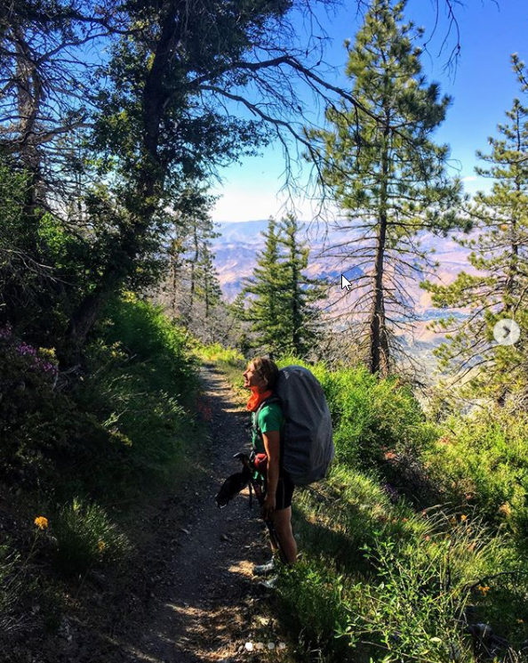
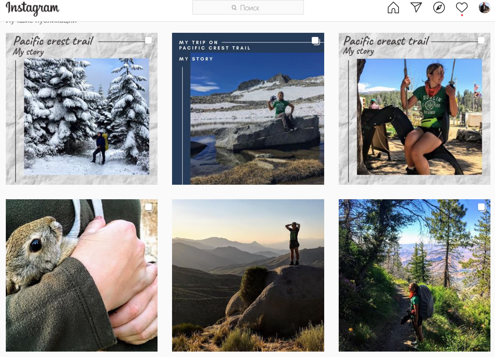


# History of irina.to.stars - 4000 km Pacific Crest Trail (USA)

After placing "Wild" at the top of our film ranking, could we have imagined that a few months later we would meet a Russian woman who could have inspired its main character? Of course, the film already had a real-life prototype in the United States.

The acquaintance happened quite by accident at a tourist rally by a common fire, when everyone in turn began to tell their stories, one girl modestly said: "I have covered four thousand kilometers of[Pacific Crest Trail (PCT)](https://en.wikipedia.org/wiki/Pacific_Crest_Trail)". The story (so far in the form of diary entries) can be read on her instagram [https://www.instagram.com/irina.to.stars/](https://www.instagram.com/irina.to.stars/) We, of course, were primarily interested in initial motivations, what were the life problems that pushed a person to this the hardest way? And of course, has this journey become the turning point in life that would give a person the strength to resolve these problems? On Irina's instagram, her life story and philosophical reflections are united by the corresponding tags [https://www.instagram.com/explore/tags/pctmystory/](https://www.instagram.com/explore/tags/pctmystory/) [https://www.instagram.com/explore/tags/pctmythinking/](https://www.instagram.com/explore/tags/pctmythinking/) .

Readers can draw their own conclusions; here we will share ours.

Modern industrial civilization often drives people into a dead end, depriving their lives of meaning — an "existential vacuum", in the terminology of psychologist and philosopher [V. Frankl](https://en.wikipedia.org/wiki/Viktor_Frankl). Remaining in this state for a long time is destructive. There are two ways out: a step down or a step up, primarily in outlook rather than intellect.

In the first case, a person suppresses the desire to understand who they are and lives by a primitive, robotic pattern that might be called "home–work". They remain human and contribute to civilization, but does this contribution match their strengths and abilities? This approach also puts an end to inner development.

The second way is a step upward: enriching life with meaning that suits the strengths and abilities nature has given us, as well as the knowledge gained from books and the many hours spent in school and university classrooms.

To take this "step up", many people, though not everyone, need a tool to break out of the cycle of everyday life. Hiking, mountain tourism and similar activities can provide such a tool, because they involve overcoming personal limitations and external difficulties, and strengthening character.

This tool can help many people. Some may need to walk 4,000 km, while for others 400 km or even 40 km may provide enough of a shake-up. Four kilometres will probably not be enough, though they can still help maintain your energy afterward.

Hiking also offers a chance to be alone and reflect on life if you travel solo, or to talk with people who may share your motivations if you travel in a group. Both experiences can be combined. Irina's diary is an example: although she walked the PCT alone for six months, she constantly crossed paths with other people and shared some of their life stories on Instagram.

Below are several passages from Irina's story that seemed central to understanding it. Of course, we do not claim to have understood it completely :).

## Before the PCT. Biography

• I grew up in an ordinary Soviet family, with Soviet attitudes and lack of money ... My parents gave me the best education - free mathematics ... As a child I was a downtrodden girl and the path to at least some kind of awareness was very long and arduous .. I already have an adult child - the best daughter in the world. There was a promising office job. A roof over your head, family and comfort.  
• I have been working in an office for 4.5 years ... I dreamed of this kind of work for a long time, sitting on a prolonged maternity leave ... Then it was my first office job ... I grew up enough in the career ladder, received a good salary , interesting complex projects ... Probably for many - this is a dream ... but! The work did not bring pleasure specifically to me ... something was not right ... I could not understand what, but I realized that something needed to be changed ...  
• At home - a relationship that has lasted for 14 years ... This is a huge period, but the further, the more I realized that we are completely different in outlook on life, in goals, in desires, in dreams ... It was hard for me to decide and leave ... family is the most sacred for me.  
• We have one life and I finally have a crazy plan: I leave work - I fill the free 8 hours with what will bring pleasure, "my friends" - I rent an apartment and move with my daughter from my husband - I return back to the office ... about all 5 months ... But something went wrong ... I quit my job, moved to my apartment (even if it was rented, but my own), and I could not go back to the office to work ... not mine? thought ... what then is mine ???

## What tasks did she solve on the PCT:

• I am able to bring the matter to the end (clearly set goal = result)  
• I understand the value of myself  
• I learn to see which goals are real at the moment  
• I build my boundaries and know how to see and protect myself from addiction and manipulation  
• I change my attitude to situations: to addiction, who is my environment and what is it for me, how does it affect me?  
• I try to write a book to get feedback and errors cannot be transferred to the printed version  
• Just writing - I am learning to structure my thoughts into words. I convey them to others and convey to the reader in the form in which they live in my head  
• Collect stories "why are they on the PCT?"

## PCT

• Yesterday I walked again without water, like only 9 km, but in the very heat, without wind and shadow Glitches began - I saw an evil human grinning face in the tree, everywhere I saw people instead of bushes ... the last kilometer - my mouth was dry, I could hardly move my legs ... muttered constantly: "water, water ..."  
• It took me a month and a half to understand how you can move in the heat, get used to the loads and start walking at least 30 km every day ... to understand that I no longer want to wander in the desert, or at least not in the summer and not for long ... favorite mountains - I think the best part of the path for me ...  
• I watch hikers: someone goes and listens to music with headphones, someone turns it on at full volume, someone hums songs himself ... I love to listen to nature ...  
• Today I remembered the true attitude towards you manifests itself in difficulties ... when everything is fine with you, people are drawn to you, they want to communicate, they play with you. And as soon as trouble happens and you need help - where are all those "acquaintances"? - scored, dissolved and threw all the memories in the trash ... Games! I hate it...  
• Observing others, I began to notice my own behavior ... You say one thing, but in reality you behave completely differently. I began to understand why people do not treat me the way I would like ...  
• Discovery: I learned to be happy and take care of others And this is the merit of trailangel. I used to be an independent woman - never take from others, everything myself. Oh wow, this is "all by herself" But when you see the kindness from the trailangel, sincere (when nothing is asked back), then you break into a smile and accept the gift with joy, also with an open heart. Sometimes I notice in others the same problems that were in me - when I see a hiker passing by and not receiving a gift from the trailangel ... Not all trailangels are sincere, there are also strange ones and expecting a response from you (more often money). On the contrary, Bill - who treats hikers with unlimited fruit and water every day. Could this be fake? Or a woman who gave a ride to the city and did not charge for gasoline. This is a sincere concern from a pure heart. The whole attitude is felt - that's enough ...

## What did you get on the PCT? Outcome

• Ability to see the world wider - there is no limit to the possibilities.  
• We are all different, but we can all learn everything. Everyone has their own abilities and their own pace, but this is not an obstacle, these are just your features. Everything is decided: work, steps, aspirations, actions, luck, chance and time.  
• Time is the most valuable resource, money cannot buy it.  
• The past cannot be changed, it is impossible to erase what has already happened. This can only be accepted, both in yourself and in others. Realize and move on.  
• Not a single situation, not one of your experiences can predict your future. All actions, thoughts, feelings - all this is only within the boundaries of a particular person and they can be anything. They may not obey common sense, logic, statistics. They are just their own. You cannot influence another person. It only remains to accept.  
• We are not insured against anything in life. There is no 100% guarantee. Everything that is happening now is already happening. And we shape the future ourselves and also now.  
• Live in the moment: here and now!  
• You are free ... free in your choice and only you can decide which choice to make  
• Our nature is not dangerous. She was given to help us. Her beauties are endless and only we can decide how much we are able to open our eyes.  
• Nothing just happens - everything is given to us for something. Everything in life has a price. You need to rely only on yourself, take responsibility for what is happening and move on ...

I'm not perfect, but I'm alive and I see value in it

 The initial translation of this page is complete with the help of a machine translator. We apologize for any errors. Work on improving the translation continues.
