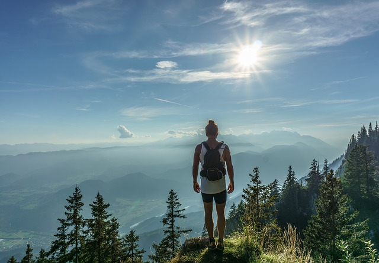
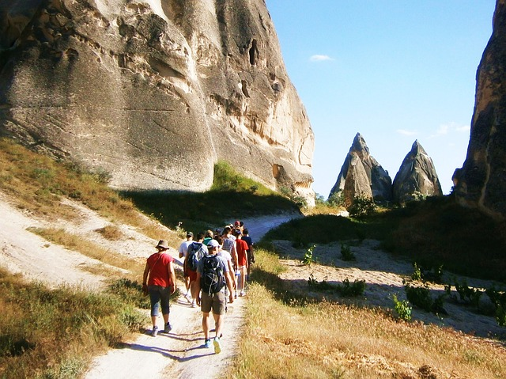
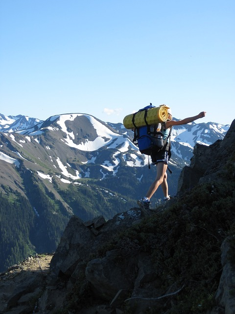
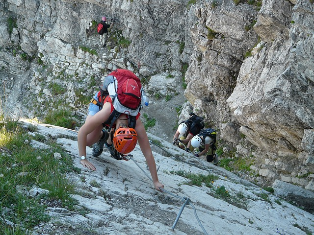
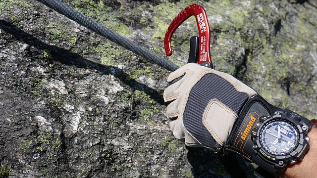

# Походная и горная терминология

В широком английском употреблении **hiking** — длительная ходьба, обычно по сельской местности, ради удовольствия, физической активности или тренировки. В российском спортивном туризме **пешеходный туризм** — дисциплина, основной целью которой является пешее преодоление группой маршрута по слабопересечённой местности.

Более детальная терминология (трекинг, хайкинг и т.д.) может иметь несколько разные оттенки значения в зависимости от местных особенностей. Тем не менее, возможно использовать следующие определения:

## Англоязычная терминология

**Хайкинг (hiking)** - это непродолжительное (как правило, однодневное) пешее путешествие налегке. Обычно употребляется в отношении горной или предгорной местности, хотя это необязательно (есть даже термин "городской хайкинг"). Хайкинг обычно осуществляется с использованием маркированных и хорошо подготовленных троп.

 [Image by Ales Krivec from Pixabay](https://pixabay.com/photos/hiker-standing-woman-top-journey-918473/)

Интересное определение хайкинга от тревел-эксперта [Евгения Дяченко](https://club-miry.ru/tour-category/evgenij-djachenko/): Хайкинг - пешее путешествие по горной местности налегке с ночевками в отелях и ужинами в кафе и ресторанах.

**Трекинг или треккинг (trekking)** - это более сложное и продолжительное пешее путешествие. Обычно с ночевками, которые (как принято в Европе) осуществляются в кемпингах или горных приютах. В то же время, трекинг часто употребляется как обобщенный термин (включающий в себя и хайкинг) и обозначает пешие путешествия по спланированным маршрутам (трек -- маршрут).

**Бэкпекинг (backpacking)** — многодневный поход с собственным снаряжением, близкий к традиционному русскоязычному пониманию похода. Ночёвки не обязательно проходят в палатках. В Северной Америке палатки распространены больше, а в Европе чаще встречаются простые укрытия и горные хижины. В Новой Зеландии tramping часто предполагает ночлег в хижинах. Британское hillwalking может обозначать как дневную прогулку, так и более длительное путешествие с разным жильём. В Южной Африке туристы также используют простые хижины. Родственные термины в других странах — trekking и bushwalking.

**Бэкпекинг**, в другом значении, — бюджетное самостоятельное путешествие, часто с принципиальным отказом от туроператоров в пользу общественного транспорта и недорогого жилья, например хостелов. Такие поездки обычно длиннее стандартного отпуска и предполагают интерес к общению с местными жителями наряду с осмотром достопримечательностей. Рюкзак распространён, но не обязателен.

 [Image by Danny Schreiner from Pixabay](https://pixabay.com/photos/cappadocia-tuff-rock-hiking-1602916/)

**Walking** - приемлемо для описания всех форм ходьбы, будь то прогулка в парке или пеший туризм в Альпах

**Rambling** (старомодный термин), hillwalking, fell walking -- в основном используется в Великобритании

**Bushwalking** (гуляющий по лесу) -- термин , использующийся в Австралии

**Tramping** - в Новой Зеландии так называют долгую энергичную прогулку или поход

## Немецкоязычная терминология

**Wandern** - пешие походы и прогулки, в основном по специальным тропам с ночлегами в хижинах.

**Bergwandern** - горные походы, с прохождением перевалов и ночлегами в палатках.

## Русскоязычная терминология

**Горный туризм**- вид туризма, заключающийся в передвижении группы людей с помощью мускульной силы по определённому маршруту, проложенному в горной местности в условиях высокогорья. Существует две дисциплины по спортивному горному туризму: маршрут горный и дистанция горная. По данным видам дисциплин проводятся соревнования как на уровне туристических клубов, так и региональных федераций по спортивному туризму.

 [Image by skeeze from Pixabay](https://pixabay.com/photos/hiker-mountain-backpacking-hiking-1763517/)

**Альпинизм** — восхождение на горные вершины; в российском горном туризме основной целью является прохождение перевалов определённой сложности, иногда с восхождениями на вершины. В высших категориях сложности границы размываются. В широком английском употреблении mountaineering включает традиционные восхождения, хайкинг, лыжные маршруты и виа-ферраты; некоторые также относят к нему занятия в помещении, спортивное скалолазание и боулдеринг.

 [Image by Hans Braxmeier from Pixabay](https://pixabay.com/photos/climber-steep-descent-climb-59681/)

**Скалолазание (rock climbing)** — подъём, спуск или траверс по естественным скалам либо искусственным стенам. Возникло как разновидность альпинизма, но стало самостоятельным спортом. Цель — пройти маршрут или достичь вершины без срыва; соревнования могут оценивать скорость либо достигнутую высоту на усложняющемся маршруте.

 [Image by joergweitz from Pixabay](https://pixabay.com/photos/climb-mountaineering-mountaineer-3590655/)

## Дополнительные определения

**Легкоходство** **(Lightweight (ultralight) backpacking)** -- направление в туризме, отличительной чертой которого является максимальное снижение веса снаряжения без угрозы безопасности. "Легкоходы -- кто это, куда они ходят и как им стать" [https://trekkingmania.ru/legkohodstvo\_eto/](https://trekkingmania.ru/legkohodstvo_eto/) Ссылки из статьи: [https://legkohod.com](https://legkohod.com) сайт с большим количеством легкоходной информации, созданный Ричардом Делонгом на русском языке. [https://vk.com/lightpacker\_ru](https://vk.com/lightpacker_ru) - группа ВКонтакте, в которой собралось множество единомышленников и производителей легкоходного снаряжения. Организаторы группы проводят ежегодный [https://trekkingmania.ru/slyot\_legkoxodov\_2018](https://trekkingmania.ru/slyot_legkoxodov_2018) слёт легкоходов. В традиционном туризме снаряжение обычно весит более 14 кг (без питания). Хотя чётких границ веса не существует, но условно легкоходов можно подразделить: легкоходы - облегчают снаряжение до 10 кг; ультралегкоходы (ультрасы) - имеют вес снаряжения около 5 кг; суперультралегкоходы - собирают экстремально лёгкие наборы снаряжения около 2.5 кг. [https://en.wikipedia.org/wiki/Ultralight\_backpacking](https://en.wikipedia.org/wiki/Ultralight_backpacking)

**Скрэмблинг (scrambling)** — передвижение по крутому рельефу с использованием рук. Занимает промежуточное положение между ходьбой, горными прогулками, альпинизмом и скалолазанием; встречается также при каньонинге.

**Альпийский скрэмблинг** - это внетрековый поход, часто по снегу или скалам, с "нетехническим" восхождением в качестве конечной точки маршрута. Нетехническим восхождением является восхождение, которое достигается без необходимости определенных видов альпинистского снаряжения (обвязок, верёвки, защитной экипировки и т.д.), и не связано с путешествием по крутым склонам или ледникам. Тем не менее, термин включает в себя перевалы через скалы с небольшим углом наклона, трекинг по осыпям, пересечение водных потоков, продирание через заросли и хождение по заснеженным склонам.

**Скандинавская ходьба (Nordic walking)** — ходьба по особой методике со специально разработанными палками, похожими на лыжные. Задействует всё тело, используется как оздоровительная активность и как спорт; стала популярна во всём мире в конце 1990-х годов.

**Каньонинг** (canyoneering в США, kloofing в Южной Африке) — прохождение каньонов без лодок, плотов и подобных средств, с использованием ходьбы, скрэмблинга, скалолазания, прыжков, спуска по верёвке и плавания. Чаще термины относятся к техническим спускам с верёвками, лазанием вниз, прыжками или сложным плаванием, хотя иногда canyoneering называют и простой пеший проход каньона. Удалённые районы требуют навыков навигации, поиска пути и автономного путешествия. [https://en.wikipedia.org/wiki/Canyoning](https://en.wikipedia.org/wiki/Canyoning)

**Автостоп (hitchhiking)** — поездка с попутными водителями, обычно незнакомыми, которых просят подвезти в направлении пункта назначения. Как правило, проезд бесплатный, но не всегда. На протяжении значительной части прошлого века автостоп также служил основным способом передвижения странствующих путешественников.  
**Использованные материалы:**

* Википедия "Пешеходный туризм" [https://ru.wikipedia.org/wiki/Пешеходный\_туризм](https://ru.wikipedia.org/wiki/Пешеходный_туризм) [https://en.wikipedia.org/wiki/Hiking](https://en.wikipedia.org/wiki/Hiking) [https://en.wikipedia.org/wiki/Scrambling](https://en.wikipedia.org/wiki/Scrambling) и другие статьи
* Трекинг, хайкинг и бэкпекинг [https://www.marshrut-club.com/articles/7654](https://www.marshrut-club.com/articles/7654)
* Что такое трекинг, хайкинг и бэкпекинг? [https://trekkingmania.ru/chto\_takoe\_treking/](https://trekkingmania.ru/chto_takoe_treking/)
* Все для хайкинга, трекинга и бэкпекинга (статья о снаряжении) [https://turclub-pik.ru/blog/vse-dlya-hajkinga-trekinga-i-bekpekinga/](https://turclub-pik.ru/blog/vse-dlya-hajkinga-trekinga-i-bekpekinga/)
* [http://ski.ru/az/blogs/post/kratkii-slovarik-lyzhebordera-v-gorakh/](http://ski.ru/az/blogs/post/kratkii-slovarik-lyzhebordera-v-gorakh/) Краткий иллюстрированный горный словарь. Например: "Кулуа́р (от фр. couloir - проход, коридор) - корытообразная или V-образная ложбина на крутом склоне горы, направленная по линии стока воды. Широкая в верхней части, сужается внизу. Кулуары достигают ширины нескольких десятков метров, простираются часто на всю высоту склона и, в зависимости от времени года и ландшафтных условий, могут быть заполнены снегом, фирном и льдом. Кулуар - естественный путь схода камнепадов и лавин. Дно кулуара часто прорезано желобом и является наиболее опасным местом в кулуаре"
* [http://svastour.ru/termin.htm](http://svastour.ru/termin.htm) туристические термины
